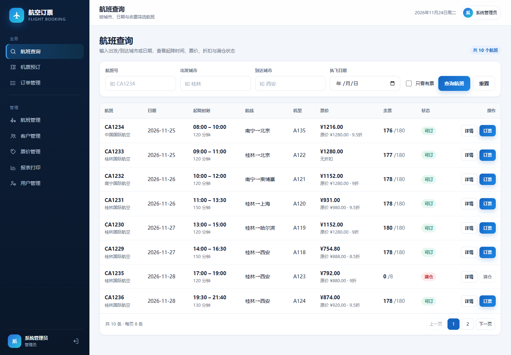
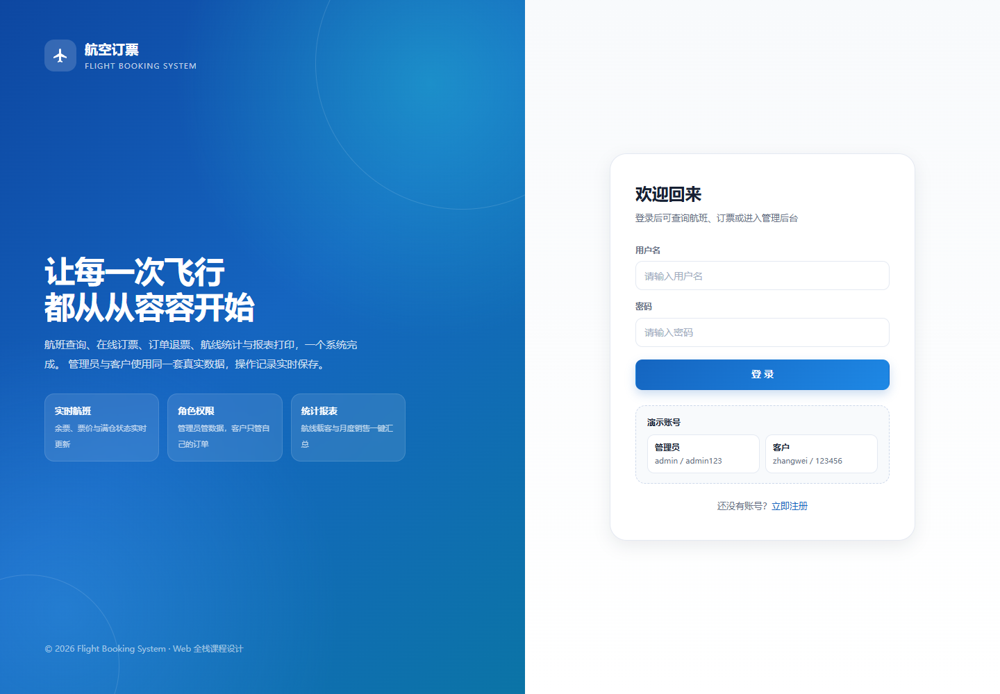
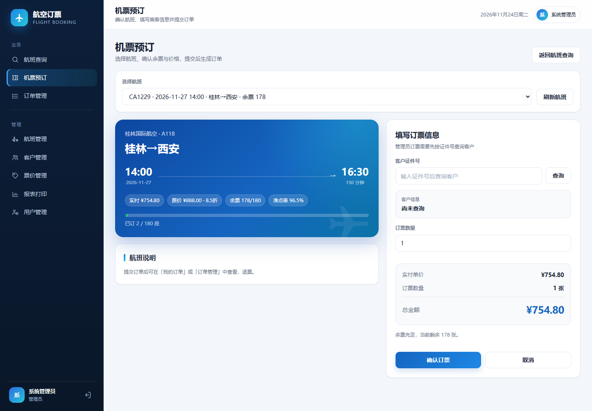
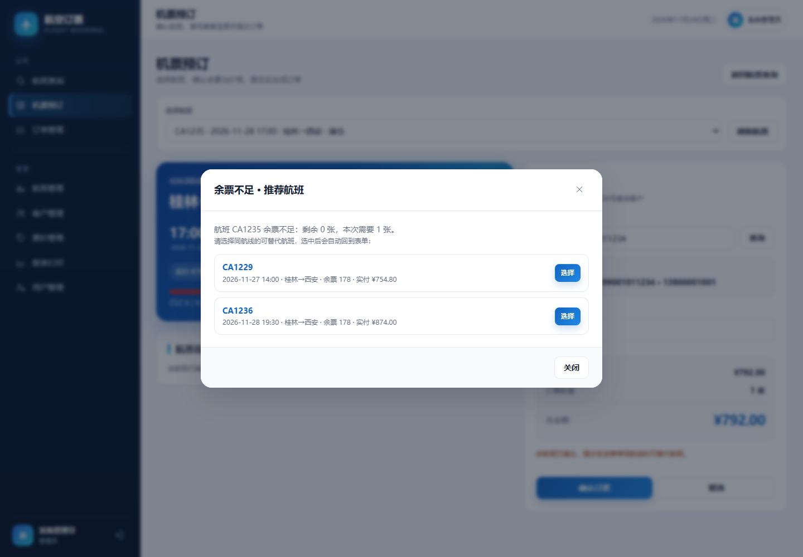
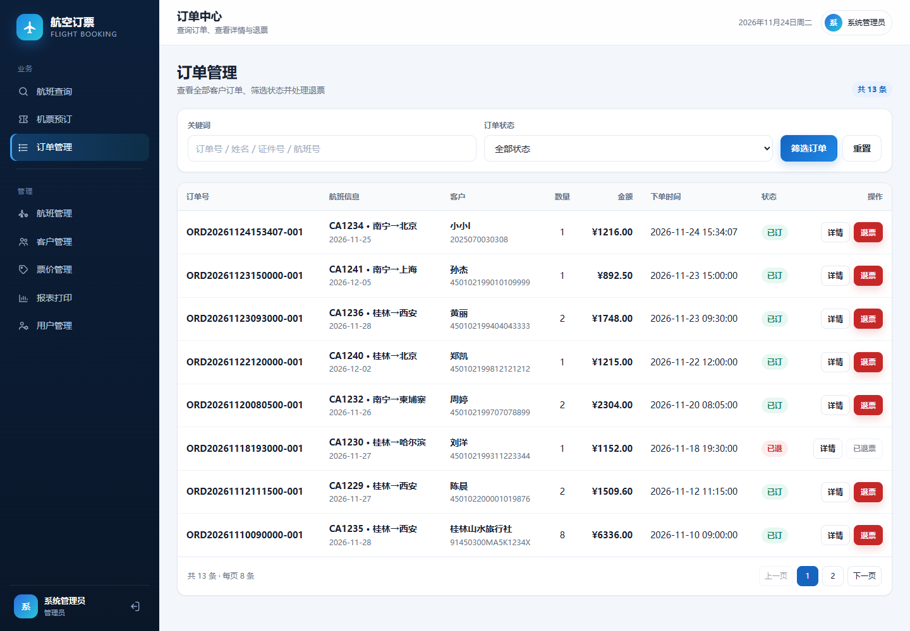
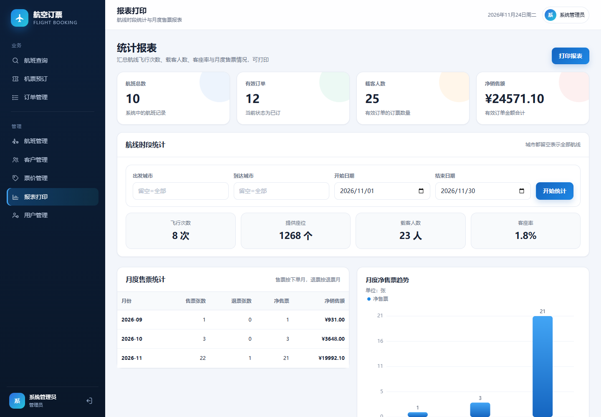
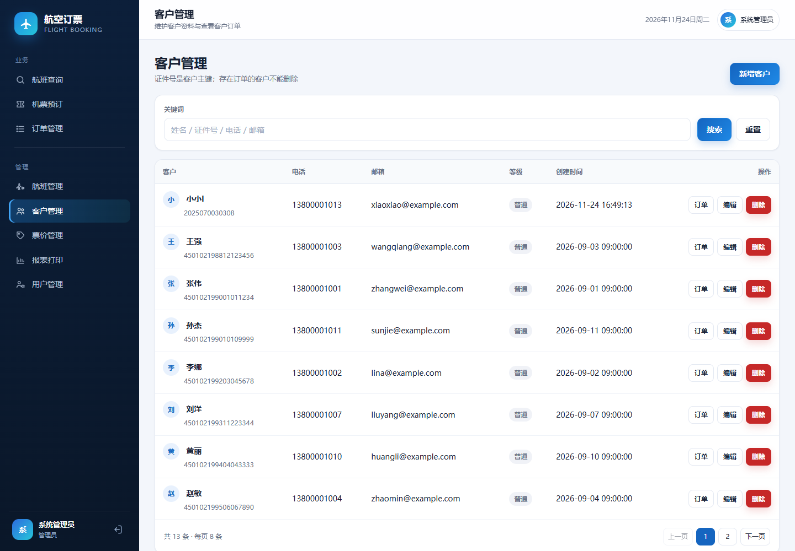
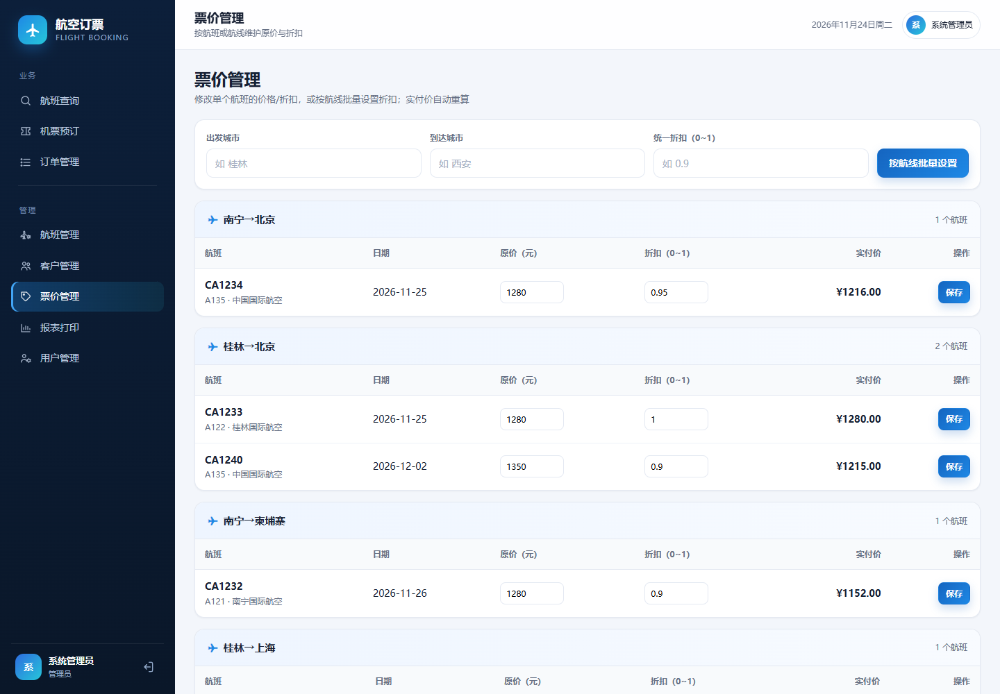

# 航空公司订票管理系统（Web 全栈版）

> Spring Boot 3.5 + 原生 HTML/CSS/JavaScript · 航班查询、订票、退票、客户/航班/票价/用户管理、统计报表
>
> 仓库：https://github.com/king001gg/Flight-oop

<p align="center">
  
</p>

## 项目简介

本项目把原先的 Java Swing 航班订票系统改造成 **Web 全栈系统**：

- **前端**：原生 HTML + CSS + JavaScript（ES Modules），不依赖 Vue/React/Bootstrap；
- **后端**：Spring Boot 3.5.16（Java 17），Spring MVC + Bean Validation + BCrypt；
- **数据**：沿用 UTF-8 文本文件（`flights.dat`、`orders.dat`），新增 `customers.dat`、`users.dat`；
- **权限**：管理员与客户两种角色，Token 认证，客户只能查看和退自己的订单；
- **交付**：10 个页面（8 个业务页面 + 登录/注册）、10 类 JavaScript 事件、REST API、测试与课设文档。

Swing 桌面版完整保存在标签 **`v2.0-java-swing`** 中，随时可以检出回退。

## 功能模块

| 页面 | 角色 | 功能 |
|---|---|---|
| `login.html` | 公开 | 登录，按角色跳转 |
| `register.html` | 公开 | 注册客户账号，同时创建客户资料 |
| `flights.html` | 登录 | 按航班号、起降城市、日期、余票查询航班 |
| `booking.html` | 登录 | 选择航班、确认乘客、计算金额、提交订单；满仓时推荐同航线航班 |
| `orders.html` | 登录 | 客户查看/退自己的订单；管理员查看全部订单并处理退票 |
| `admin-flights.html` | 管理员 | 航班增删改查 |
| `admin-customers.html` | 管理员 | 客户资料增删改查、查看客户订单 |
| `admin-fares.html` | 管理员 | 按航班改价/折扣、按航线批量设置折扣 |
| `admin-users.html` | 管理员 | 用户账号、角色、重置密码、删除约束 |
| `reports.html` | 管理员 | 航线时段统计、月度售票统计、Canvas 图表、打印 |

## 界面预览

### 登录

<p align="center"></p>

### 订票与满仓推荐

<p align="center"></p>

<p align="center"></p>

### 订单管理与统计报表

<p align="center"></p>

<p align="center"></p>

### 管理端

<p align="center"></p>

<p align="center"></p>

## 技术栈

| 层 | 技术 |
|---|---|
| 前端 | HTML5、CSS3（Grid/Flex/变量/响应式）、原生 JavaScript ES Modules、Canvas 2D |
| 后端 | Java 17、Spring Boot 3.5.16、Spring MVC、Bean Validation |
| 认证 | BCrypt 密码哈希（spring-security-crypto）+ 内存 Bearer Token |
| 数据 | UTF-8 文本文件，`::` 分隔；临时文件 + 替换写入 |
| 构建 | Maven + Maven Wrapper（首次运行自动下载 Maven） |
| 测试 | JUnit 5、Spring Boot Test、MockMvc；Playwright 真实浏览器验证 |

## 快速开始

### 环境要求

- JDK 17 或更高版本
- 首次构建需要网络（下载 Maven 和依赖）

### 启动

Windows：

```bat
mvnw.cmd spring-boot:run
```

macOS / Linux：

```bash
./mvnw spring-boot:run
```

浏览器访问 **http://localhost:8080**。

首次启动会自动：

1. 下载 Maven（Maven Wrapper）；
2. 下载 Spring Boot 依赖；
3. 把 `src/main/resources/seed/` 中的示例数据复制到 `data/`；
4. 生成默认账号。

### 默认账号

| 角色 | 用户名 | 密码 | 说明 |
|---|---|---|---|
| 管理员 | `admin` | `admin123` | 全部功能 |
| 客户 | `zhangwei` | `123456` | 关联张伟的客户资料，只能看自己的订单 |

### 测试

```bat
mvnw.cmd test
```

或：

```bash
./mvnw test
```

当前共有 **8 项 API 集成测试**，使用独立临时数据目录，不会污染 `data/`。

### 重置示例数据

停止服务后删除 `data/` 目录，再次启动即可从 `seed/` 重新生成。

## 总体架构

```text
浏览器（HTML + CSS + JavaScript ES Modules）
        │  fetch /api/*
        ▼
Spring Boot 3.5.16（Java 17）
  ├─ Controller / DTO / Bean Validation / 全局异常
  ├─ AuthInterceptor（Bearer Token + 角色）
  ├─ Service
  │    ├─ FlightSystem（航班 + 订单 + 统计）
  │    ├─ CustomerStore
  │    ├─ UserStore
  │    └─ AuthService
  ├─ Domain：Flight、Order、Customer、User
  ├─ 文件存储（UTF-8，:: 分隔）
  └─ 静态资源：src/main/resources/static
        ▼
data/
  flights.dat  orders.dat  customers.dat  users.dat
```

单进程、单端口 8080，同时提供页面和 API，同源，无需 CORS。

## 项目结构

```text
oop/
├── pom.xml
├── mvnw / mvnw.cmd / .mvn/wrapper/
├── data/                              # 运行时数据（忽略）
├── src/main/java/oop/
│   ├── WebApplication.java            # Spring Boot 入口
│   ├── Flight.java / Order.java
│   ├── Customer.java / User.java
│   ├── FlightSystem.java              # 航班/订单/统计/持久化
│   ├── CustomerStore.java / UserStore.java / DataFiles.java
│   ├── AuthService.java
│   ├── config/                        # 数据装配、拦截器、示例数据初始化
│   ├── dto/                           # 请求/响应 DTO
│   └── web/                           # 控制器、鉴权、异常处理
├── src/main/resources/
│   ├── application.properties
│   ├── seed/                          # 示例数据
│   └── static/                        # 前端 10 个页面 + CSS/JS
├── src/test/java/oop/web/             # MockMvc 集成测试
├── docs/
└── README.md
```

## 页面与 JavaScript 事件

### 页面

登录、注册不计入课程要求的 4 个界面，其余 **8 个业务页面** 均可独立访问：

`flights.html`、`booking.html`、`orders.html`、`admin-flights.html`、`admin-customers.html`、`admin-fares.html`、`admin-users.html`、`reports.html`。

### JavaScript 事件（10 类）

| 事件 | 使用位置 |
|---|---|
| `click` | 导航、查询、订票、退票、分页、Modal、打印、推荐航班选择 |
| `submit` | 登录、注册、筛选、订票、后台表单 |
| `change` | 城市/日期/状态筛选、角色选择、数量联动 |
| `input` | 实时搜索、表单校验、票价/数量联动计算 |
| `keydown` | 客户查询回车、Esc 关闭 Modal |
| `dblclick` | 航班/客户/用户表格行双击编辑 |
| `mouseover` | 余票提示、行悬停 |
| `DOMContentLoaded` | 页面初始化、数据加载、角色菜单渲染 |
| `scroll` | 顶栏吸附阴影 |
| `resize` | Canvas 图表自适应重绘 |

## API 摘要

统一前缀 `/api`，成功响应：

```json
{ "code": 0, "message": "ok", "data": {} }
```

| 模块 | 主要接口 |
|---|---|
| 认证 | `POST /api/auth/login`、`POST /api/auth/register`、`POST /api/auth/logout`、`GET /api/auth/me` |
| 航班 | `GET /api/flights?from=&to=&date=&onlyAvailable=`、`GET /api/flights/{id}` |
| 订单 | `GET /api/orders`、`POST /api/orders`、`GET /api/orders/{id}`、`POST /api/orders/{id}/refund` |
| 航班管理 | `GET/POST/PUT/DELETE /api/admin/flights/**` |
| 票价管理 | `PUT /api/admin/flights/{id}/fare`、`POST /api/admin/fares/bulk` |
| 客户管理 | `/api/admin/customers/**`、`GET /api/customers/me` |
| 用户管理 | `/api/admin/users/**` |
| 统计 | `/api/stats/route`、`/api/stats/monthly`、`/api/stats/summary` |
| 健康检查 | `GET /api/health` |

完整接口、请求/响应示例见 **[docs/api.md](docs/api.md)**。

## 数据模型

### `flights.dat`（12 字段）

`flightId::date::takeOffTime::durationMinutes::startCity::endCity::planeModel::price::discount::totalSeats::airline::onTimeRate`

### `orders.dat`（9 字段）

`orderId::flightId::customerName::customerId::quantity::orderTime::unitPrice::status::refundTime`

### `customers.dat`（6 字段）

`customerId::name::phone::email::level::createdAt`

证件号作为客户主键；订单保留姓名/证件号快照。

### `users.dat`（5 字段）

`username::passwordHash::role::displayName::customerId`

密码使用 BCrypt 哈希；客户角色通过 `customerId` 关联客户资料。

## 业务规则

- 余票 = 总座位 − 有效订单（`BOOKED`）数量之和，订票/退票后立即重算；
- 订单号格式：`ORD + yyyyMMddHHmmss + "-" + 三位序号`；
- 满仓/余票不足时返回 409，并携带同航线、余票足够的替代航班；
- 退票为整单退票，状态置为 `REFUNDED`，座位自动回补；
- 有订单的航班不能删除，也不能修改航班号；总座位不能小于已订数；
- 有订单的客户不能删除；
- 不能删除当前登录账号或最后一个管理员；
- 保存采用临时文件 + 替换，失败回滚内存状态。

## 测试与验证

### 后端自动化测试

`./mvnw test` 共 8 项集成测试，覆盖：

- 健康检查、登录、Token 与 401/403 权限；
- 注册创建客户 + 用户、重复注册拒绝；
- 航班按城市查询、航线统计、月度统计；
- 满仓订票 409 + 替代航班；
- 订票/退票与座位回补；
- 客户不能操作他人订单；
- 航班/客户/用户 CRUD、有订单时的删除/改号约束、按航线批量折扣。

结果：**Tests run: 8, Failures: 0, Errors: 0**。

### 浏览器端到端验证

使用 Playwright 在真实浏览器中验证：

- 管理员登录 → 报表页数据加载；
- 航班号筛选 CA1235 → 满仓状态；
- 管理员查询客户 → 满仓订票 → 409 推荐 CA1229/CA1236 → 选择替代航班；
- 客户登录 → 订票 CA1229 成功 → 订单页出现新订单 → 退票成功 → 座位恢复到 178/180；
- 客户访问管理页自动跳回航班查询；
- 航班/客户/票价/用户管理页面的查询、Modal、角色切换；
- 测试完成后恢复测试前数据。

详细用例见 **[docs/test-plan.md](docs/test-plan.md)**。

## Web 课设要求对照

| 要求 | 实现 |
|---|---|
| 至少 4 个界面（登录/注册除外） | 8 个业务页面 |
| 使用 HTML + CSS + JavaScript | 原生 HTML/CSS/JS，ES Modules，无前端框架 |
| 至少 4 类 JavaScript 事件 | 10 类事件，见上表 |
| 需求分析、总体设计、详细设计、测试 | [docs/web-course-design.md](docs/web-course-design.md) |
| 功能模块覆盖 | 登录、注册、航班查询、订票、订单/退票、客户管理、航班管理、票价管理、报表打印、用户管理 |

## 与桌面版的关系

- 桌面版完整代码保存在 **`v2.0-java-swing`** 标签；
- 主分支已转为 Web 全栈版，不再维护 Swing 客户端；
- 可随时通过 `git switch --detach v2.0-java-swing` 查看桌面版。

## 已知限制

- Token 保存在内存中，服务重启后需要重新登录；
- 单进程运行，多个实例同时写同一 `data/` 目录可能互相覆盖；
- 不包含真实支付、短信、邮件、第三方航班数据；
- 退票只支持整单退票，不支持部分退票/改签/手续费；
- 客户证件号等资料以文本文件保存，仅适合课程演示；
- 前端页面需要后端服务，不能离线打开 HTML 使用；
- 首次 Maven 构建依赖网络。

## 文档

- [设计规格](docs/superpowers/specs/2026-11-24-flight-web-fullstack-design.md)
- [Web 课设设计报告](docs/web-course-design.md)
- [API 文档](docs/api.md)
- [测试计划与结果](docs/test-plan.md)
- 页面截图：`docs/screenshots/web/`

## 许可

本项目为 Web 前端与 Java 全栈课程设计项目，仅用于学习交流；未附带开源许可证。
