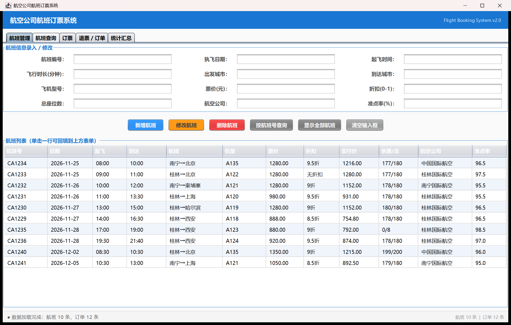
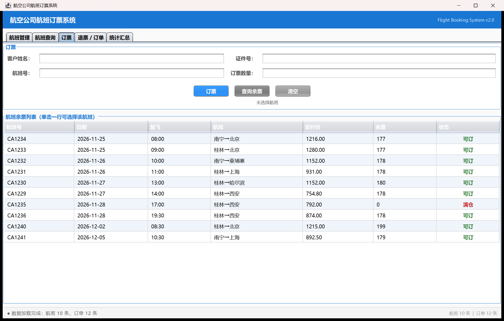
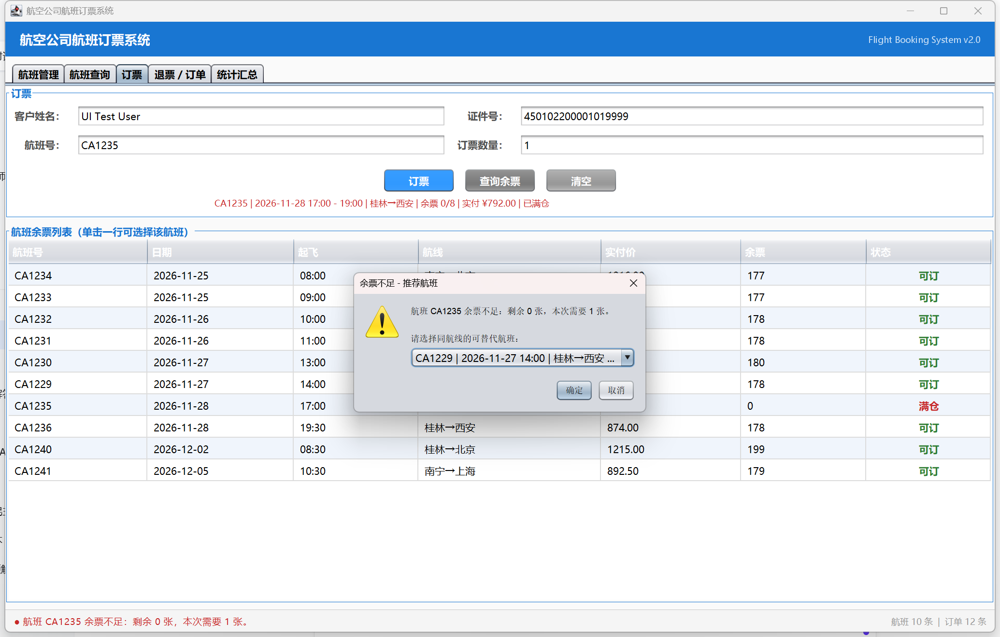
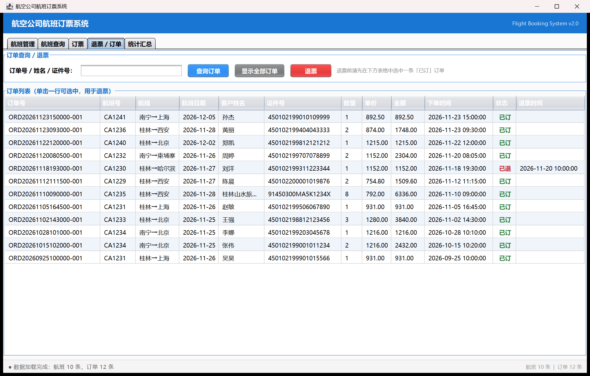
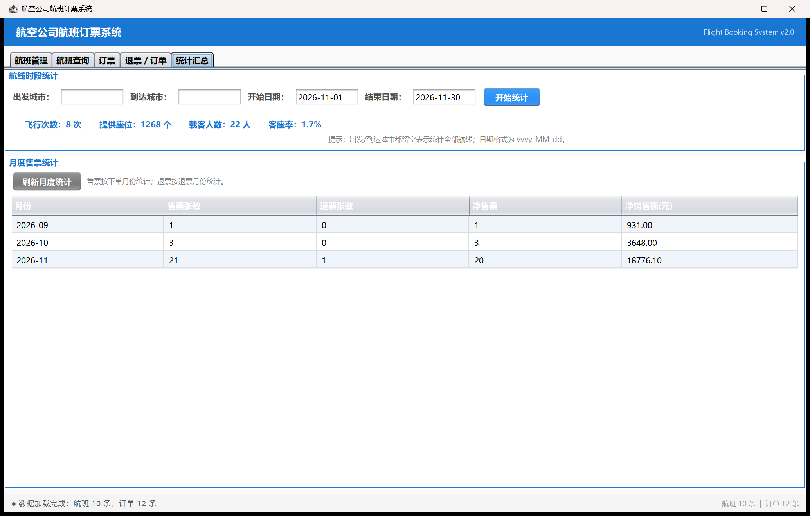
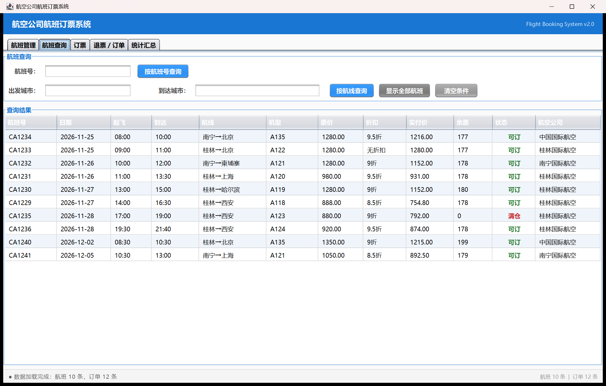
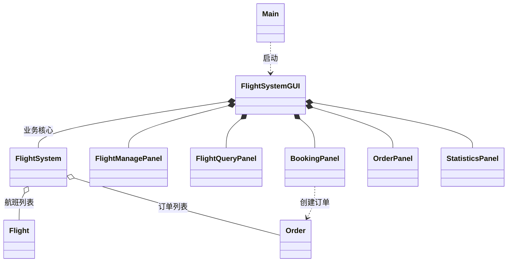

# ✈ 航空公司航班订票系统

> Java Swing 桌面应用 · 航班管理 / 查询 / 订票 / 退票 / 统计汇总

<p align="center">
  
</p>

## 项目简介

本项目是一个面向对象程序设计与数据结构练习项目，使用 **Java Swing** 实现“航空公司航班订票系统”。系统采用多页签界面，覆盖课设要求的六项功能：

- **航班管理**：录入、修改、删除航班，数据保存在 `flights.dat`；
- **航班查询**：按航班号或“出发城市 + 到达城市”查询，展示起降时间、票价、折扣和满仓状态；
- **订票**：录入客户姓名、证件号和数量生成订单，订单保存在 `orders.dat`；余票不足时自动推荐同航线的可替代航班；
- **退票**：按订单号 / 姓名 / 证件号查询订单，整单退票并自动回补座位；
- **统计汇总**：统计某航线一段时间内的飞行次数、载客人数、客座率，以及每个月的售票与退票情况。

项目源码约 **3280 行**，全部使用 JDK 标准库，无第三方依赖。

## 功能与题目要求对照

| 课设要求 | 实现情况 | 对应界面 |
|---|---|---|
| (1) 录入航班情况，数据存文件 | ✅ 完整航班表单：编号、日期、起飞时间、时长、起降城市、机型、票价、折扣、总座位、航司、准点率；写入 `flights.dat` | 航班管理 |
| (2) 按航班号查询航线情况 | ✅ 精确查询；结果含起降时间（到达时刻自动计算）、起降城市、票价、折扣、是否满仓 | 航班查询 / 航班管理 |
| (2) 按起飞、抵达城市查询航班 | ✅ “出发城市 + 到达城市”组合查询 | 航班查询 |
| (3) 订票，无票时推荐航班 | ✅ 生成唯一订单号；余票不足时弹出同航线、余票足够的替代航班供选择 | 订票 |
| (4) 退票并修改数据文件 | ✅ 客户资料含姓名、证件号、订票数量、航班；订单有编号；退票后状态、座位与文件同步更新 | 退票 / 订单 |
| (5) 修改航班信息 | ✅ 选中表格行回填表单后修改；有订单时禁止改航班号、禁止删除，总座位不得低于已订数 | 航班管理 |
| (6) 汇总航线时段与月度销售 | ✅ 按航线 + 日期区间统计飞行次数、提供座位、载客人数、客座率；按自然月统计售票/退票/净销售额 | 统计汇总 |

## 界面预览

### 订票与航班余票

<p align="center">
  
</p>

### 余票不足时推荐同航线航班

<p align="center">
  
</p>

### 订单查询与退票

<p align="center">
  
</p>

### 航线时段统计与月度售票统计

<p align="center">
  
</p>

### 按航班号 / 按航线查询

<p align="center">
  
</p>

## 技术栈

- **语言 / 平台**：Java SE 17+（已在 OpenJDK 17.0.20 上编译运行验证）
- **GUI**：Swing / AWT，Nimbus Look and Feel
- **数据存储**：`java.io` / `java.nio.file` 文本文件（UTF-8，字段以 `::` 分隔）
- **依赖 / 构建**：仅 JDK 标准库，无 Maven / Gradle，无第三方依赖

## 快速开始

### 环境要求

- JDK 17 或更高版本（可用 `javac -version` / `java -version` 自检）

### 命令行运行

在项目根目录（本 README 所在目录）执行：

```bash
# 1. 编译（源码含中文，必须指定 UTF-8）
javac -encoding UTF-8 -d out/production/oop src/oop/*.java

# 2. 运行
java -cp out/production/oop oop.Main
```

> ⚠️ 请从项目根目录启动。程序按**相对路径**读写 `flights.dat` 和 `orders.dat`，从其他目录启动会读写另一份数据文件（不存在时表现为空数据）。

### 在 IntelliJ IDEA 中运行

1. `File → Open`，选择本项目目录；
2. 确认 Project SDK 为 JDK 17 及以上：`File → Project Structure → Project`；
3. 如果 `src` 未被识别为源码目录，右键 `src → Mark Directory as → Sources Root`；
4. 打开 `src/oop/Main.java`，运行 `main` 方法。

> `.idea/`、`out/`、`*.iml` 已被 `.gitignore` 忽略，因此从干净仓库导入时需要手动标记 `src` 为 Sources Root。

## 项目结构

```text
oop/
├── src/oop/
│   ├── Main.java                 # 程序入口：在 EDT 中创建主窗口
│   ├── Flight.java               # 航班实体（含时刻计算、折扣价、余票等派生属性）
│   ├── Order.java                # 订单实体（客户资料、数量、金额、状态、退票时间）
│   ├── FlightSystem.java         # 业务核心：加载/保存、查询、订票、退票、统计
│   ├── FlightSystemGUI.java      # 主窗口：五个页签 + 状态栏
│   ├── FlightManagePanel.java    # 航班管理页签
│   ├── FlightQueryPanel.java     # 航班查询页签
│   ├── BookingPanel.java         # 订票页签（含满仓推荐）
│   ├── OrderPanel.java           # 退票 / 订单页签
│   ├── StatisticsPanel.java      # 统计汇总页签
│   ├── UiUtils.java              # 字体、颜色、按钮、表格等公共样式
│   ├── FlightSystemException.java# 业务异常
│   ├── NoSeatsException.java     # 余票不足异常（携带替代航班）
│   ├── RouteStatistics.java      # 航线时段统计结果
│   └── MonthStatistics.java      # 月度售票统计结果
├── flights.dat                   # 航班数据（UTF-8，:: 分隔，12 字段）
├── orders.dat                    # 订单数据（UTF-8，:: 分隔，9 字段）
├── docs/                         # README 截图
├── out/production/oop/           # 编译输出（已忽略）
└── README.md
```

## 数据文件格式

### `flights.dat`：航班数据（12 字段）

每行一条航班记录，字段使用 `::` 分隔，UTF-8 编码，无表头：

| 序号 | 字段 | 示例 | 说明 |
|---|---|---|---|
| 1 | 航班编号 | `CA1234` | 唯一标识 |
| 2 | 执飞日期 | `2026-11-25` | `yyyy-MM-dd` |
| 3 | 起飞时间 | `08:00` | `HH:mm` |
| 4 | 飞行时长 | `120` | 分钟数，正整数 |
| 5 | 出发城市 | `南宁` | |
| 6 | 到达城市 | `北京` | |
| 7 | 飞机型号 | `A135` | |
| 8 | 票价 | `1280.0` | 原价 |
| 9 | 折扣 | `0.95` | `0~1`，0.95 表示 9.5 折 |
| 10 | 总座位数 | `180` | 正整数 |
| 11 | 所属航空公司 | `中国国际航空` | |
| 12 | 准点率 | `96.5` | 0~100（%） |

示例行：

```text
CA1234::2026-11-25::08:00::120::南宁::北京::A135::1280.0::0.95::180::中国国际航空::96.5
```

> 已订座位数**不写入** `flights.dat`，而是由 `orders.dat` 中状态为 `BOOKED` 的订单实时汇总得到，保证“订单是座位的唯一数据源”，避免两个文件不一致。

### `orders.dat`：订单数据（9 字段）

每行一条订单记录，字段使用 `::` 分隔，UTF-8 编码：

| 序号 | 字段 | 示例 | 说明 |
|---|---|---|---|
| 1 | 订单编号 | `ORD20261110090000-001` | 系统生成，全局唯一 |
| 2 | 航班编号 | `CA1235` | 关联 `flights.dat` |
| 3 | 客户姓名 | `桂林山水旅行社` | |
| 4 | 证件号 | `91450300MA5K1234X` | 身份证 / 护照 / 单位证件 |
| 5 | 订票数量 | `8` | 正整数 |
| 6 | 下单时间 | `2026-11-10 09:00:00` | `yyyy-MM-dd HH:mm:ss` |
| 7 | 成交单价 | `792.0` | 下单时的折后单价 |
| 8 | 状态 | `BOOKED` | `BOOKED`（已订）或 `REFUNDED`（已退） |
| 9 | 退票时间 | `2026-11-20 10:00:00` | 未退票时为空字符串 |

示例行（未退票时最后一列为空，因此行尾是 `::`）：

```text
ORD20261110090000-001::CA1235::桂林山水旅行社::91450300MA5K1234X::8::2026-11-10 09:00:00::792.0::BOOKED::
```

### 读取规则

- 空行自动跳过；字段数不正确或日期 / 数字格式错误的行会被跳过，并在启动弹窗中提示行号；
- 航班号、订单号重复时，重复行被忽略；
- 订单引用了不存在的航班时，该订单被忽略并提示；
- 加载时若发现已订座位数超过总座位数，会给出告警（界面余票按 0 显示）；
- 航班号、城市、机型、航司、客户姓名、证件号等文本字段不能包含分隔符 `::`。

> **格式变更说明**：旧版本（v1）的 `flights.dat` 是 9 字段格式；本版本改为 12 字段（增加日期、折扣、总座位，调整字段顺序）。仓库内的数据文件已经更新为新格式，旧数据需要转换后才能导入。

## 业务规则

1. **余票计算**：`余票 = 总座位数 − 该航班所有 BOOKED 订单的数量之和`。订票、退票后会立即重新汇总。
2. **订单编号**：`ORD + yyyyMMddHHmmss + "-" + 三位序号`，生成时检查是否与已有订单重复。
3. **订票校验**：航班必须存在；姓名、证件号不能为空；数量必须为正整数；余票不足时抛出 `NoSeatsException`，并附带同航线、余票足够的替代航班列表。
4. **退票**：整张订单退票，状态置为 `REFUNDED` 并记录退票时间，座位自动回补；已退订单不能重复退票。
5. **修改航班**：航班已有订单时不能修改航班编号；总座位数不能小于当前已订座位数；票价 / 折扣调整只影响之后的订票，已有订单保留下单时的单价。
6. **删除航班**：只要存在任何关联订单（含已退票订单），就禁止删除，避免订单历史失去关联。
7. **保存策略**：每次增、删、改、订票、退票后立即保存；先写 `.tmp` 临时文件再替换目标文件，保存失败会回滚内存中的修改并在状态栏提示。

## 类设计



| 类 | 职责 |
|---|---|
| `Main` | 程序入口，通过 `SwingUtilities.invokeLater` 在 EDT 中创建主窗口 |
| `Flight` | 航班实体，封装 12 个持久化字段 + 派生的到达时刻、折后价、余票、满仓判断，并实现 `Comparable` 按日期/时间排序 |
| `Order` | 订单实体，包含客户资料、数量、下单时间、成交单价、状态与退票时间 |
| `FlightSystem` | 业务核心：文件读写、索引重建、航班增删改查、订票/退票、航线统计、月度统计 |
| `FlightSystemGUI` | 主窗口：页签组织、状态栏、统一刷新与消息提示 |
| `FlightManagePanel` | 航班录入、修改、删除、按航班号筛选、显示全部 |
| `FlightQueryPanel` | 按航班号查询、按起降城市查询，展示满仓状态 |
| `BookingPanel` | 订票表单、余票列表、满仓/余票不足推荐 |
| `OrderPanel` | 订单查询、订单列表、整单退票 |
| `StatisticsPanel` | 航线时段统计、月度售票统计 |
| `UiUtils` | 公共颜色、字体、按钮、表格样式、金额/折扣格式化 |
| `FlightSystemException` / `NoSeatsException` | 业务异常与余票不足异常（携带替代航班） |
| `RouteStatistics` / `MonthStatistics` | 统计结果对象 |

## 数据结构设计

为满足数据结构课设的展示需要，业务层在 `FlightSystem` 中组合使用了多种结构：

| 数据结构 | 用途 | 说明 |
|---|---|---|
| `ArrayList<Flight>`（保持有序） | 全部航班按“日期 → 起飞时间 → 航班号”排序 | 统计日期区间时用**二分查找**定位起止下标，避免全表扫描 |
| `HashMap<String, Flight>` | 航班号 → 航班 | 按航班号查询、订票、修改、删除均为 O(1) |
| `HashMap<String, List<Flight>>` | 航线（出发→到达）→ 航班列表 | 按城市对查询、满仓时推荐同航线航班 |
| `HashMap<String, Order>` | 订单号 → 订单 | 退票、订单查询 O(1) |
| `ArrayList<Order>`（按时间倒序） | 订单列表展示 | 每次数据变更后重排 |
| `TreeMap` / `TreeSet` | 按 `YearMonth` 汇总售票、退票与销售额 | 天然按月份有序输出 |

每次增删改后调用 `rebuildIndexes()` 重建哈希索引、航线索引和已订座位，保证派生数据一致。

## 统计口径

### 航线时段统计

输入出发城市、到达城市、开始日期、结束日期（城市都留空表示全部航线），统计：

- **飞行次数**：区间内该航线的航班记录条数；
- **提供座位**：这些航班的总座位数之和；
- **载客人数**：这些航班当前有效订单（`BOOKED`）的订票数量之和，已退票不计入；
- **客座率**：载客人数 ÷ 提供座位数。

### 月度售票统计

- **售票张数**：按下单月份归集所有订单的订票数量（含事后退票的订单）；
- **退票张数**：按退票时间归集退票数量；
- **净售票**：当月售票 − 当月退票；
- **净销售额**：当月售票金额 − 当月退票金额。

## 使用说明

1. **航班管理**：填写 12 个字段 → 点击「新增航班」。单击表格行可回填表单，再点「修改航班」；删除前会弹出确认框。
2. **航班查询**：输入完整航班号点「按航班号查询」；或输入出发/到达城市点「按航线查询」。满仓航班的状态列显示红色「满仓」。
3. **订票**：填写客户姓名、证件号、航班号、订票数量 → 点击「订票」。也可以直接单击余票列表中的航班自动填入航班号。若余票不足，会弹出「余票不足 - 推荐航班」对话框，列出同航线、余票足够的替代航班，选中后回到表单再次订票。
4. **退票 / 订单**：按订单号 / 姓名 / 证件号查询；在表格中选中一条订单 → 点击「退票」→ 确认。退票后状态变为「已退」，座位自动回补。
5. **统计汇总**：填写航线和日期区间 → 「开始统计」；月度售票表格在数据变化后自动刷新，也可以手动点「刷新月度统计」。

## 示例数据与快速演示

仓库自带 10 个航班（2026-11-25 ~ 2026-12-05）和 12 张订单（2026-09 ~ 2026-11），并特意设计了以下演示场景：

- **CA1235**（桂林→西安，2026-11-28，总座位 8）被旅行社订单订满，余票为 **0/8**。在「订票」页签输入 CA1235、任意客户和数量 1，即可看到「余票不足 - 推荐航班」弹窗，推荐同航线的 **CA1229** 与 **CA1236**。
- **航线统计**：出发城市 `桂林`、到达城市 `西安`、日期 `2026-11-01 ~ 2026-11-30`，应得到 **飞行 3 次、368 个座位、载客 12 人**。
- **月度统计**：2026-09 售票 1 张；2026-10 售票 3 张；2026-11 售票 21 张、退票 1 张、净售票 20 张、净销售额 18776.10 元。
- 示例中订单 `ORD20261118193000-001`（客户刘洋）已退票，可用于观察退票状态与座位回补。

## 验证情况

开发过程中使用独立的临时测试脚本对业务层执行了 52 项断言，全部通过，覆盖：

- 航班/订单加载与文件往返（重启后票价、退票状态、余票仍正确）；
- 重复航班号、重复退票、非法数量、有订单时改号/删除、座位数低于已订数等约束；
- 满仓订票抛出 `NoSeatsException` 且替代航班按时间排序正确；
- 订票/退票后的余票回补与订单数量变化；
- 航线时段统计（含二分查找的日期边界）、月度售票/退票/净销售额；
- 全部航线统计与城市留空规则。

界面已实际启动验证：五个页签切换、数据加载、满仓红色状态、订票表单校验、余票不足推荐弹窗和统计结果均正常。测试脚本为开发期临时文件，未包含在仓库中。

## 已知限制

- 退票只支持**整单退票**，暂不支持部分退票；
- 同一订单的座位在退票时全部回补，不支持按数量部分回退；
- 单机单实例设计，没有并发控制；多个程序实例同时写同一数据文件可能互相覆盖；
- 客户证件号以明文保存在文本文件中，仅适用于课程演示；
- 退票没有时间限制、手续费或改签逻辑；
- 按城市查询使用**精确匹配**，不支持模糊查询或周边城市；
- 航班改期/改价后，历史订单仍保留下单时的成交单价，但航线时段统计会按新日期归档航班；
- 数据文件字段不能包含 `::`；没有导入 / 导出 / 自动备份界面；
- 未提交自动化 GUI 测试（业务层验证见上一节）。

## 许可

本项目为面向对象程序设计与数据结构课程练习项目，仅用于学习交流；未附带开源许可证。
