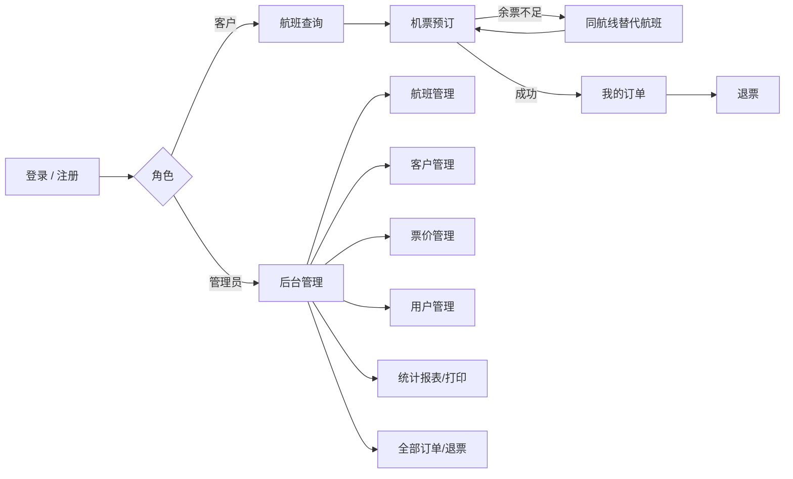

# Web 前端课程设计报告：航空公司订票管理系统

> 课程设计：Web 前端课程设计
> 系统名称：航空公司订票管理系统（Web 全栈版）
> 技术路线：HTML + CSS + JavaScript 前端，Java Spring Boot 后端
> 日期：2026-11-24

---

## 1. 需求分析

### 1.1 项目背景

航空公司需要一套系统来管理航班信息、客户订票、退票和销售统计。传统做法是桌面管理软件；本项目改为浏览器访问的 Web 系统，管理员在后台维护航班、客户、票价和用户，客户在浏览器中查询航班、在线订票、查看订单并退票。

系统同时满足两类课程要求：

- **Web 前端课程设计**：至少 4 个界面（登录/注册除外），使用 HTML/CSS/JavaScript，至少 4 类 JavaScript 事件；
- **Java / 数据结构课程设计**：用 Java 完成业务逻辑、数据文件存储、查询/排序/统计等处理。

### 1.2 用户角色

| 角色 | 权限 |
|---|---|
| 游客 | 登录、注册 |
| 客户（CUSTOMER） | 查询航班、订票、查看自己的订单、退自己的订单、维护个人资料 |
| 管理员（ADMIN） | 客户全部权限 + 航班管理、客户管理、票价管理、报表打印、用户管理、查看全部订单 |

### 1.3 功能需求

1. **登录 / 注册**：用户名密码登录；注册时同时创建客户资料；按角色跳转。
2. **航班查询**：按航班号、出发城市、到达城市、日期、是否有票筛选；显示起降时间、城市、机型、票价、折扣、余票、满仓状态。
3. **机票预订**：选择航班、确认乘客、填写数量、计算总金额、提交订单；余票不足时推荐同航线可替代航班。
4. **订单管理 / 退票**：客户看自己的订单，管理员看全部订单；按订单号/姓名/证件号/航班号搜索，按状态筛选；整单退票并回补座位。
5. **客户管理**：客户资料增删改查；查看客户订单；有订单的客户不能删除。
6. **航班管理**：航班增删改查；有订单的航班不能删除或改航班号；总座位不能小于已订数。
7. **票价管理**：单个航班改原价/折扣；按航线批量设置折扣；实付价自动重算。
8. **报表打印**：航线时段统计（飞行次数、座位数、载客人数、客座率）、月度售票统计（售票/退票/净售票/净销售额）、柱状图、浏览器打印。
9. **用户管理**：账号增删改查、角色管理、重置密码；不能删除自己或最后一个管理员。

### 1.4 非功能需求

- **界面**：统一设计系统，响应式，支持桌面和手机宽度；状态颜色清晰。
- **安全**：密码只存 BCrypt 哈希；Token 鉴权；客户数据隔离；管理接口仅管理员可访问。
- **数据一致性**：余票由订单推导；保存失败回滚；座位/订单同步。
- **可维护性**：前后端分层；路由、DTO、Service、Store 边界清晰；共享 CSS/JS。
- **可演示性**：一条命令启动；默认账号；示例数据；满仓航班用于演示推荐。

## 2. 系统流程



主要流程说明：

1. 用户登录/注册后，前端保存 Token 和用户信息；
2. 客户查询航班 → 选择航班 → 填写数量 → 提交订单；
3. 若余票不足，后端返回 409 和替代航班，前端展示选择；
4. 客户在“我的订单”中查看、退票；管理员在“订单管理”中处理全部订单；
5. 管理员维护航班/客户/票价/用户，查看统计报表并打印。

## 3. 总体设计

### 3.1 系统架构

```text
浏览器（HTML/CSS/JS）
  │ fetch /api/*
  ▼
Spring Boot（Controller → Service → Store → 文件）
  │
  ├─ AuthInterceptor（Token + 角色）
  ├─ FlightSystem（航班/订单/统计）
  ├─ CustomerStore / UserStore
  └─ data/*.dat（UTF-8，:: 分隔）
```

前后端同源部署：Spring Boot 同时提供静态页面和 REST API，端口 8080。

### 3.2 功能模块划分

| 模块 | 前端页面 | 后端 |
|---|---|---|
| 认证 | login.html / register.html | AuthController、AuthService、UserStore |
| 航班查询 | flights.html | FlightController、FlightSystem |
| 订票 | booking.html | OrderController、FlightSystem |
| 订单/退票 | orders.html | OrderController、FlightSystem |
| 航班管理 | admin-flights.html | AdminFlightController |
| 客户管理 | admin-customers.html | AdminCustomerController、CustomerStore |
| 票价管理 | admin-fares.html | AdminFareController、FlightSystem |
| 报表打印 | reports.html | StatisticsController |
| 用户管理 | admin-users.html | AdminUserController、UserStore |

### 3.3 技术选型

| 项 | 选择 |
|---|---|
| 前端 | HTML5 / CSS3 / 原生 JavaScript ES Modules |
| 图表 | Canvas 2D 手写柱状图 |
| 后端 | Java 17 + Spring Boot 3.5.16 |
| 校验 | Jakarta Bean Validation |
| 密码 | BCrypt（spring-security-crypto） |
| 鉴权 | Bearer Token（UUID，内存 8 小时） |
| 数据 | UTF-8 文本文件，临时文件 + 替换写入 |
| 构建 | Maven + Maven Wrapper |
| 测试 | JUnit 5 + MockMvc + Playwright |

### 3.4 数据模型

| 文件 | 字段 |
|---|---|
| `flights.dat` | 航班编号、日期、起飞、时长、出发城市、到达城市、机型、原价、折扣、总座位、航司、准点率 |
| `orders.dat` | 订单号、航班号、客户姓名、证件号、数量、下单时间、成交单价、状态、退票时间 |
| `customers.dat` | 证件号、姓名、电话、邮箱、会员等级、创建时间 |
| `users.dat` | 用户名、BCrypt 密码哈希、角色、显示名、关联证件号 |

核心关系：

- 订单通过 `flightId` 关联航班，通过 `customerId`（证件号）关联客户；
- 余票不单独存储，由状态为 `BOOKED` 的订单数量实时汇总；
- 用户通过 `customerId` 关联客户资料；管理员没有客户资料。

## 4. 详细设计

### 4.1 页面设计

#### 登录 / 注册

- 左侧品牌区（航空蓝渐变、系统卖点），右侧表单卡片；
- 演示账号一键填充；登录按角色跳转；
- 注册校验用户名、密码、确认密码、姓名、证件号。

#### 航班查询

- 筛选栏：航班号、出发城市、到达城市、日期、只看有票；
- 表格列：航班、日期、起降时刻、航线、机型、票价/折扣、余票、状态、操作；
- 支持行点击详情、双击进入订票、分页、输入防抖搜索；
- 满仓航班状态红色徽章，订票按钮禁用。

#### 机票预订

- 航班下拉选择（含余票/满仓提示）+ 航班摘要卡；
- 客户：自动带出本人资料；管理员：按证件号查询客户；
- 数量输入实时计算单价/数量/总金额；
- 提交前确认弹窗；409 时展示替代航班列表，一键切换。

#### 订单 / 退票

- 关键词 + 状态筛选；分页；
- 客户只看到自己的订单，管理员看到全部；
- 详情 Modal；已订订单可退票，已退订单按钮禁用；
- 退票二次确认，成功后刷新状态与座位。

#### 后台管理

- 航班管理：12 字段表单 Modal，新增/编辑/删除，双击行编辑；
- 客户管理：客户 Modal、等级、查看客户订单；
- 票价管理：按航线分组，行内改价/折扣、实付价实时计算、批量折扣；
- 用户管理：新增/编辑/重置密码/删除，角色切换显示证件号字段；
- 报表打印：KPI 卡片、航线统计表单/结果、月度表格、Canvas 图表、打印按钮。

### 4.2 JavaScript 事件设计

| 事件 | 典型用途 |
|---|---|
| `click` | 导航、查询、订票、退票、分页、Modal、打印、选择替代航班 |
| `submit` | 登录、注册、筛选、订票、后台表单 |
| `change` | 城市/日期/状态筛选、角色选择、数量联动 |
| `input` | 实时搜索、表单校验、票价/数量联动 |
| `keydown` | 回车查询客户、Esc 关闭 Modal |
| `dblclick` | 后台表格行进入编辑 |
| `mouseover` | 余票提示/行悬停 |
| `DOMContentLoaded` | 页面初始化、数据加载、角色菜单 |
| `scroll` | 顶栏吸附阴影 |
| `resize` | Canvas 图表自适应重绘 |

### 4.3 鉴权设计

1. 登录成功后后端生成 UUID Token，返回用户信息；
2. 前端保存 `{token, user}` 到 localStorage；
3. 每次请求携带 `Authorization: Bearer <token>`；
4. `AuthInterceptor` 校验 Token；`/api/admin/**` 要求 ADMIN；
5. 401 时前端清除会话并跳转登录；
6. 退出登录删除 Token。

### 4.4 文件存储与一致性

- 每个 Store 负责一个 `.dat` 文件；
- 读取时跳过空行/格式错误行，记录告警；
- 写入时先写 `.tmp` 再替换，避免中途失败截断原文件；
- `FlightSystem` 的读写方法加锁，适配 Spring 多线程；
- 每次增删改/订票/退票后立即保存；失败回滚内存。

### 4.5 关键业务规则

- 余票 = 总座位 − BOOKED 订单数量；
- 订单号唯一；
- 满仓/余票不足返回 409 + 替代航班；
- 退票整单，状态 REFUNDED，座位回补；
- 有订单的航班不能删/改号；总座位不能小于已订；
- 有订单的客户不能删；不能删自己/最后一个管理员。

## 5. 测试

### 5.1 测试环境

- JDK 17.0.20
- Spring Boot 3.5.16
- Chrome / Playwright
- 数据：seed 示例数据（10 个航班、13 张订单、13 个客户）
- 测试命令：`mvnw.cmd test`

### 5.2 后端自动化测试

| 编号 | 用例 | 预期 |
|---|---|---|
| T01 | 未登录访问 `/api/flights` | 401 |
| T02 | 管理员/客户登录 | 200 + Token |
| T03 | 注册创建客户与用户；重复注册 | 200；400 |
| T04 | 按城市查询、航线统计、月度统计 | 结果正确 |
| T05 | 满仓航班订票 | 409 + 2 个替代航班 |
| T06 | 订票后余票减少、退票后恢复 | 正确 |
| T07 | 客户访问他人订单 | 403 |
| T08 | 管理员 CRUD / 约束 / 批量折扣 | 正确 |

结果：**8 项全部通过**。

### 5.3 浏览器端到端测试

| 场景 | 结果 |
|---|---|
| 管理员登录 → 报表页 | 通过，KPI/航线/月度数据正确 |
| 航班号筛选 CA1235 | 1 条，满仓红色状态 |
| 满仓订票 → 推荐替代航班 | 409 弹窗，CA1229/CA1236，可选择 |
| 客户登录 → 订票 CA1229 | 成功生成订单并跳转订单页 |
| 客户退票 | 状态变已退，CA1229 余票恢复 178/180 |
| 客户访问管理页 | 自动跳回航班查询 |
| 后台航班/客户/票价/用户 Modal | 打开、回填、角色切换正常 |
| 响应式/打印 | 布局正常，报表打印样式生效 |

测试完成后已把 `data/` 恢复到测试前状态，未保留测试订单。

## 6. 总结与不足

### 6.1 完成情况

- 10 个页面（8 个业务页面 + 登录/注册）；
- 10 类 JavaScript 事件；
- 完整 REST API、角色权限、BCrypt 密码、Token 会话；
- 航班/订单/客户/用户文件存储与业务约束；
- 统计报表、Canvas 图表、打印；
- 8 项后端集成测试 + 真实浏览器端到端验证；
- 桌面版完整保留在 `v2.0-java-swing` 标签。

### 6.2 不足与改进方向

- Token 存内存，服务重启需重新登录；可改为 Redis/JWT；
- 单进程文件存储，不支持多实例并发；可改为数据库；
- 退票只支持整单，可增加部分退票、改签、手续费；
- 无真实支付、短信/邮件通知；
- 前端未引入构建工具/组件库，页面较多时维护成本会增加；
- 可增加更多自动化 UI 测试与 CI。

---

## 附录：运行与账号

```bat
mvnw.cmd spring-boot:run
```

访问 http://localhost:8080

- 管理员：`admin / admin123`
- 客户：`zhangwei / 123456`

详细接口见 [api.md](api.md)，测试记录见 [test-plan.md](test-plan.md)，页面截图见 `screenshots/web/`。
